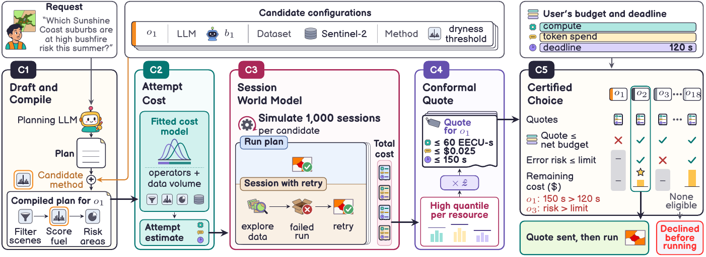

# AgentQuote: Multi-Dimensional Cost Quoting for Pay-as-You-Go Data Agents

> Data agents let users perform complex analyses on pay-as-you-go platforms, where each execution consumes computing resources, LLM tokens and time. Before an analysis starts, a service must give a reliable cost quote so that users can judge whether it is affordable. However, unlike traditional queries with predefined plans, data agents explore data, execute workflows and revise failed attempts based on feedback. Consequently, a session's total cost is unknown in advance and can far exceed that of one successful run. Existing cost estimators count only that run, while methods that bound each resource separately cannot guarantee that all limits hold at once. We propose AgentQuote, a framework that quotes the multi-dimensional cost of a whole data-agent session before it runs. AgentQuote drafts the plan with a low-cost LLM, prices one clean run and simulates the surrounding exploration and retries with a session world model learned from logged sessions. One conformal factor makes all bounds hold jointly, and a Learn-then-Test threshold picks the cheapest configuration within budget while bounding the share of requests answered wrongly or over the quote.

Details of the method and experimental results can be found in our paper.

## Running

1. Create a conda environment: `conda create -n agentquote python=3.12`, activate it: `conda activate agentquote`, and install the required packages: `pip install -r requirements.txt`.

2. Read and run `run_all.sh`. It generates metered Earth Engine and BigQuery sessions, fits and calibrates AgentQuote and the baselines over random splits, and runs every analysis. Use `QUICK=1 bash run_all.sh` for a small run of a few minutes.

3. Results are written to `results/`: one JSON file per analysis and platform, the main tables in `results/summary.md`, and the figures in `results/figures/`.

To run a single analysis, use `python -m agentquote.experiments <task> --data data --out results`, where `<task>` is one of `prepare`, `breakdown`, `quotes`, `choice`, `ablation`, `shift`, `efficiency`, `sensitivity`, `case` and `figures`. Settings such as α, δ and the number of rollouts are in `agentquote/config.py`.

## Collecting live sessions

1. Copy `.env.example` to `.env` and fill in your LLM API key and Google Cloud project.

2. Download [Spider 2.0-Lite](https://github.com/xlang-ai/Spider2), CBGB, UnivEARTH, [Sen1Floods11](https://github.com/cloudtostreet/Sen1Floods11) and [Natural Earth](https://www.naturalearthdata.com/) into `data_cache/`, following [data/README.md](data/README.md).

3. Build the Earth Engine requests: `python scripts/build_ee_requests.py --out data/earthengine`.

4. Collect sessions on each platform, for example: `python scripts/collect_sessions.py --platform bigquery --out data/bigquery --max-usd 50`.

5. Run `SKIP_GENERATE=1 bash run_all.sh` to use the collected sessions instead of the generated ones.

## License

MIT. See [LICENSE](LICENSE).
